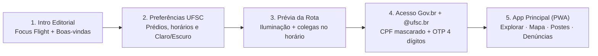

<div align="center">
  
  <h1>RuaEscura — UFSC Campus Trindade</h1>
  <p>
    <strong>Caminhe pela UFSC no claro.</strong><br />
    Navegação noturna inteligente por corredores iluminados, monitoramento colaborativo de postes via QR Code e grupos de caminhada verificados no Campus Trindade.
  </p>
  <p>
    
    
    
    
    
    
  </p>
</div>

---

## O Problema e o Propósito (Alinhamento com o Canvas)

Estudantes e servidores da **UFSC (Campus Trindade — Florianópolis)** frequentemente evitam usar a universidade à noite — deixando de aproveitar espaços como a **Biblioteca Universitária (BU)**, o **Restaurante Universitário (RU)**, o **Centro de Cultura e Eventos** e o **Centro de Desportos (CDS)** — por insegurança nos deslocamentos noturnos causada por iluminação insuficiente, postes depredados pós-festas e sensação de isolamento ao caminhar.

O **RuaEscura** traduz integralmente os 9 blocos do Canvas de produto em uma experiência mobile-first e instalável (PWA):

| Bloco do Canvas | Como o RuaEscura resolve no aplicativo |
| --- | --- |
| **Problema & Causas** | Roteamento em grafo pondera iluminação real dos corredores, postes em alerta e ocorrências comunitárias — evitando atalhos escuros automaticamente. |
| **Setores mais afetados** | Mapeamento real das rotas críticas da Trindade: **Túnel do EQA**, **CDS → BU**, **Saída pela Elase**, **CFH ↔ DCE**, **Entorno do CFM**, **Bosque** e **Colégio de Aplicação** (19 locais e 12 postes monitorados). |
| **Depredação pós-festas** | Reporte em 1 toque de poste **Depredado (pós-festa)** (`burnReason: 'depredacao_festa'`) na aba **Postes** e marcador opcional nas **Denúncias**, recalculando desvios na hora. |
| **Modelo estilo BlaBlaCar** | Grupos de caminhada com **ponto de encontro exato**, **horário de saída**, **vagas**, convite para WhatsApp (`wa.me`) e check-in de chegada (**"Cheguei bem ✓"**) no chat em grupo. |
| **Segurança para mulheres** | Opção de **Grupo Feminino verificado**: visível e utilizável apenas para contas femininas, filtrando automaticamente participantes pelo primeiro nome extraído do e-mail institucional **`@ufsc.br`**. |
| **Ocupação noturna do campus** | Seção **Campus à noite** (`BU 24h`, `RU Jantar`, `Cultura & Eventos`, `CDS Noturno`) e sugestões dinâmicas de rotas seguras ancoradas ao ponto de partida atual do usuário. |

---

## Como o Aplicativo Funciona



1. **Onboarding progressivo em modo claro por padrão:** apresentação interativa com entrada animada, escolha de prédios frequentes (incluindo CTC/EPS, CFM, CDS, DCE, Túnel EQA, Elase), alternância instantânea Claro/Escuro e cadastro Gov.br + e-mail institucional `@ufsc.br` (`@grad.ufsc.br`, `@posgrad.ufsc.br`, `@ufsc.br`) com tela animada de **Código de verificação (OTP)**.
2. **Explorar (`ExploreTab`):** card de telemetria luminosa do trajeto ativo, atalhos dinâmicos **Rotas seguras perto de você** ancorados ao ponto de origem selecionado, faixa **Campus à noite**, avaliação comunitária de trechos (1 a 5 estrelas) e tutorial interativo para instalar como PWA.
3. **Mapa Inteligente (`MapTab` + `CampusMap` + `RouteSheet`):** mapa Leaflet OpenStreetMap com modo noturno sem chave de API paga (filtro CSS restrito ao `.leaflet-tile-pane`), fallback vetorial SVG offline para todos os passeios do campus, comparação lado a lado (**Mais Iluminada** vs **Mais Rápida**), exportação direta de caminhada no Google Maps / Apple Maps e chat em tempo real no painel inferior.
4. **Postes & QR Code (`LightsTab`):** scanner/seletor de etiquetas QR dos postes (`POSTE-BU-01`, `POSTE-EQA-01`, etc.) para marcar status (`Aceso`, `Oscilando`, `Queimado` ou `Depredado pós-festa`) e recalcular imediatamente todas as rotas do campus.
5. **Denúncias & Emergência (`ReportsTab`):** canal seguro com modal de emergência para Segurança UFSC `(48) 3721-9555` e PM `190`, upload de foto com validação por Magic Bytes e remoção de metadados EXIF, e feed anônimo filtrável.

---

## Stack Técnica & Decisões de Arquitetura

| Camada | Tecnologia / Padrão | Por que escolhemos |
| --- | --- | --- |
| **UI & Core** | **React 19 + TypeScript 5.7 + Vite 6.2** | Tipagem estrita, `React.lazy` por aba/painel e build enxuto com pré-compressão `.gz` e `.br` no plugin do Vite. |
| **Estilização & Movimento** | **Tailwind CSS v4 + Motion (`motion/react`) + CSS Modules** | Design system semântico claro (`#EAEFF6`) e escuro Opal Slate (`#0A0A0A`) com tokens Apple iOS 26, `layoutId` springs e suporte completo a `prefers-reduced-motion`. |
| **Motor de Rotas** | **Dijkstra Multi-Fator (`src/engine/routing.ts`)** | Pondera distância real em metros (waypoints OSM da Trindade) contra status dos postes (`queimado` +100, `oscilando` +25), denúncias ativas (+35) e avaliações dos usuários (1–5 estrelas). |
| **Mapas em Claro & Escuro** | **Leaflet 1.9 + OpenStreetMap + Esri Satélite** | Tiles noturnos renderizados via filtro CSS no `.leaflet-tile-pane` em vez de provedores pagos/restritos (eliminando marcas d'água `API KEY REQUIRED`), preservando as cores reais das rotas e marcadores e garantindo fallback vetorial SVG offline. |
| **Validação & Segurança** | **Zod + Zero-Trust Storage + `genderGuard.ts`** | Schemas fail-fast contra XSS (`<`, `>`, `javascript:`, `on*=`), proteção contra *prototype pollution* no `localStorage`, verificação de CPF com mascaramento estrito (`***.XXX.XXX-**`), EXIF stripping em imagens e allowlist SSRF em `src/utils/network.ts`. |
| **Proteção em Grupos Femininos** | **`src/security/genderGuard.ts`** | Oculta e bloqueia criação/participação de **Grupo Feminino** quando o primeiro nome extraído do e-mail `@ufsc.br` (ou sessão) é masculino, e exclui automaticamente contas masculinas da lista de convites. |
| **Autenticação @ufsc.br OTP** | **Híbrida: Supabase Auth HTTP + Sandbox (`ufscOtpAuth.ts`)** | Envia/valida OTP real via Supabase (`/auth/v1/otp` e `/auth/v1/verify`) quando `VITE_SUPABASE_URL` e `VITE_SUPABASE_ANON_KEY` estão presentes em HTTPS; opera em modo *sandbox* local sem dependências externas fora do ar. |
| **Estado & Tempo Real** | **Local-first Context + `BroadcastChannel`** | Sincronização instantânea entre abas (`rua-escura-campus-sync`), mensagens de chat com indicador de digitação, recibo de leitura e reações em emoji. |
| **PWA** | **`manifest.webmanifest` + Service Worker (`sw.js`)** | App instalável em iOS (Safari) e Android (Chrome) com ícones vetoriais próprios, cache same-origin de app shell em produção e tutorial animado integrado no aplicativo. |

---

## Estrutura do Projeto

```text
├── index.html                          # CSP estrita, viewport-fit e metadados PWA/iOS
├── public/
│   ├── manifest.webmanifest            # Manifesto instalável do PWA RuaEscura
│   ├── sw.js                           # Service Worker same-origin para shell offline
│   └── icons/                          # Ícones SVG do PWA (192x192 e 512x512)
└── src/
    ├── engine/routing.ts               # Algoritmo Dijkstra iluminado multi-critério
    ├── data/ufscTrindade.ts            # Grafo UFSC Trindade (19 locais, 12 postes, walkways OSM)
    ├── hooks/useCampusStore.ts         # Store reativa, grupos, check-in, postes e BroadcastChannel
    ├── services/ufscOtpAuth.ts         # Envio/validação de OTP institucional @ufsc.br
    ├── security/
    │   ├── schemas.ts                  # Validação Zod (Gov.br, UFSC email, grupos, denúncias, QR)
    │   ├── genderGuard.ts              # Filtro por e-mail institucional para Grupos Femininos
    │   ├── fileValidation.ts           # Magic Bytes + remoção de EXIF em fotos
    │   └── storage.ts                  # Persistência segura anti-prototype pollution
    ├── components/
    │   ├── onboarding/                 # FocusFlightIntro, InteractiveCrewSignUp, VerificationCodeOtp, PwaInstallGuideSheet
    │   ├── explore/                    # ExploreTab, RouteStatusCard (rotas perto de você + Campus à noite)
    │   ├── map/                        # MapTab, CampusMap, RouteSheet, CompanionChatView
    │   ├── lights/                     # LightsTab (QR + Depredado pós-festa)
    │   ├── reports/                    # ReportsTab + modal de emergência
    │   └── profile/                    # ProfileSheet (tema, luz noturna, privacidade e guia PWA)
    └── __tests__/                      # Testes unitários e de fluxo com Vitest + Testing Library
```

---

## Como Rodar Localmente

### Pré-requisitos
- **Node.js 20+** (recomendado 22+ ou 24+) e `npm`

### Instalação e Execução

```bash
# Instalar dependências
npm install

# Rodar servidor de desenvolvimento (http://localhost:5173)
npm run dev

# Checagem de tipos, testes automatizados e build de produção
npx tsc --noEmit
npm test
npm run build

# Visualizar build de produção (inclui registro do Service Worker PWA)
npm run preview
```

### Configuração Opcional de OTP Real com Supabase
Por padrão o app funciona integralmente offline/local (em modo *sandbox*, o e-mail demo `mariana.silva@grad.ufsc.br` utiliza o código `5739`). Para disparar e-mails OTP reais em produção via Supabase Auth:

1. Crie um projeto no Supabase e habilite **Email OTP** (template de 4–6 dígitos).
2. Configure as variáveis de ambiente antes do `npm run build` / deploy:

```bash
VITE_SUPABASE_URL=https://seu-projeto.supabase.co
VITE_SUPABASE_ANON_KEY=sua-chave-anon-publica
```

---

## Como Instalar como PWA no Celular

Dentro do aplicativo, acesse **Perfil → Instalar app no celular (PWA)** (ou **Explorar → Instalar no celular (PWA) → Ver passo a passo**) para abrir o tutorial animado com o guia visual:

- **iPhone / iPad (Safari):** toque em **Compartilhar** (`↗`) → **Adicionar à Tela de Início** → **Adicionar**.
- **Android (Chrome):** toque em **Instalar agora com 1 toque** (quando exibido) ou no menu **`⋮` → Instalar aplicativo**.

---

## Licença & Uso Acadêmico

Projeto acadêmico voltado à segurança e mobilidade noturna na **UFSC — Campus Trindade**. Em situações reais de emergência no campus, acione sempre a **Segurança Institucional UFSC `(48) 3721-9555`** ou a **Polícia Militar `190`**.
